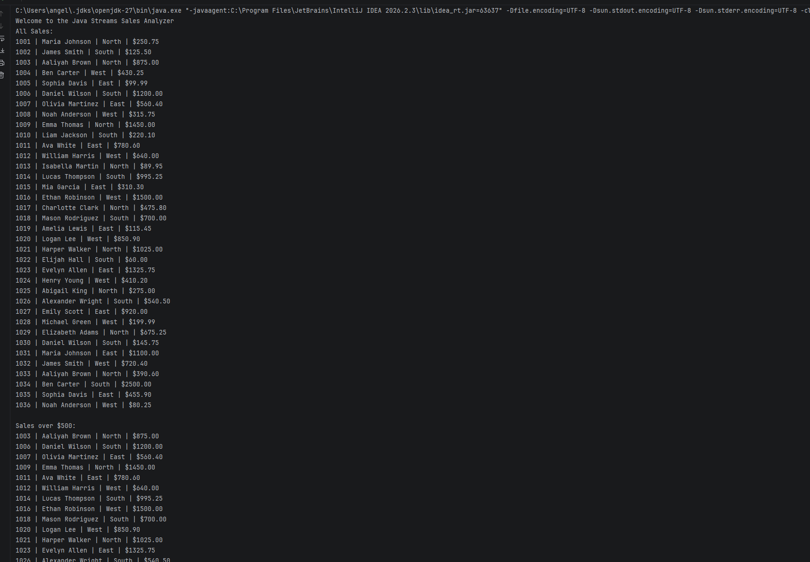
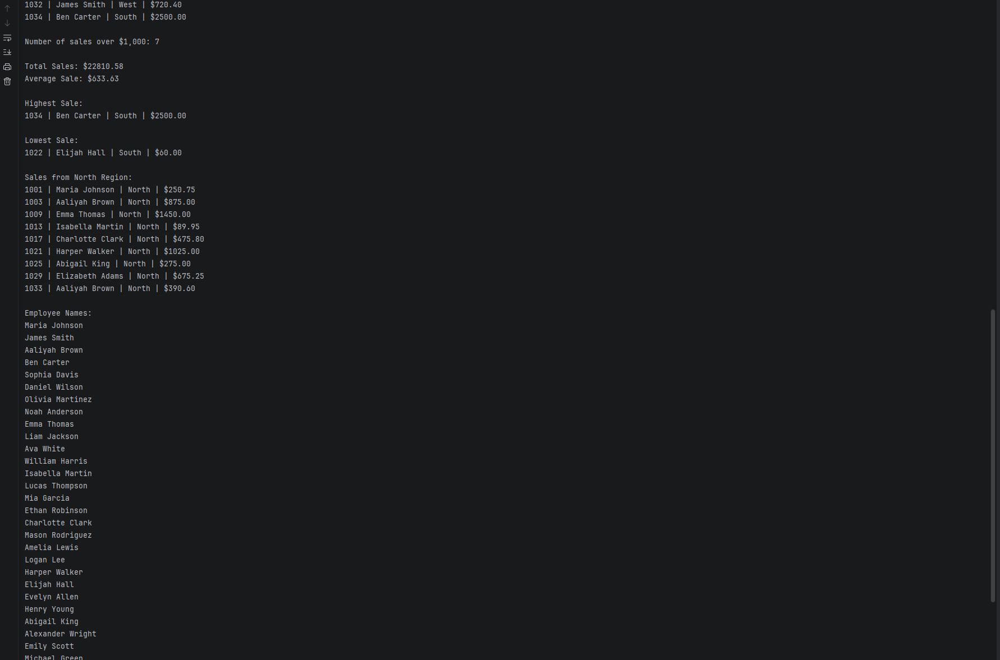

# Sales Data Stream Analyzer

## Description
This Java program reads sales records from a CSV file, stores each record as a `Sale` object in a `List<Sale>`, and uses Java Streams to analyze the data. The program displays:

- All sales
- Sales over $500
- Number of sales over $1,000
- Total sales amount
- Average sale amount
- Highest sale
- Lowest sale
- Sales from one region (North)
- Employee names only

Stream operations used include `stream()`, `filter()`, `map()`, `mapToDouble()`, `count()`, `sum()`, `average()`, `min()`, `max()`, and `forEach()`.

## Files
- `src/Sale.java` - Sale class with fields, constructor, getters, and `toString()`
- `src/Main.java` - Reads the CSV file and runs the stream analysis
- `sales.csv` - Sales data used by the program

## How to Run
1. Clone or download this repository.
2. Open the project in IntelliJ IDEA.
3. Make sure `sales.csv` is in the project root folder (same level as `src`).
4. Open `Main.java` and click the green Run button next to `main`.
5. View the results in the Run window.

## CSV File
`sales.csv` contains 36 sales records with a header row. Each row has four comma-separated fields:

| Field | Type | Example |
|---|---|---|
| SaleID | int | 1001 |
| Employee | String | Maria Johnson |
| Region | String | North |
| Amount | double | 250.75 |

The program skips the header row, splits each line on commas, converts the Sale ID to an `int` and the amount to a `double`, and creates a `Sale` object for each row.

## Screenshots

